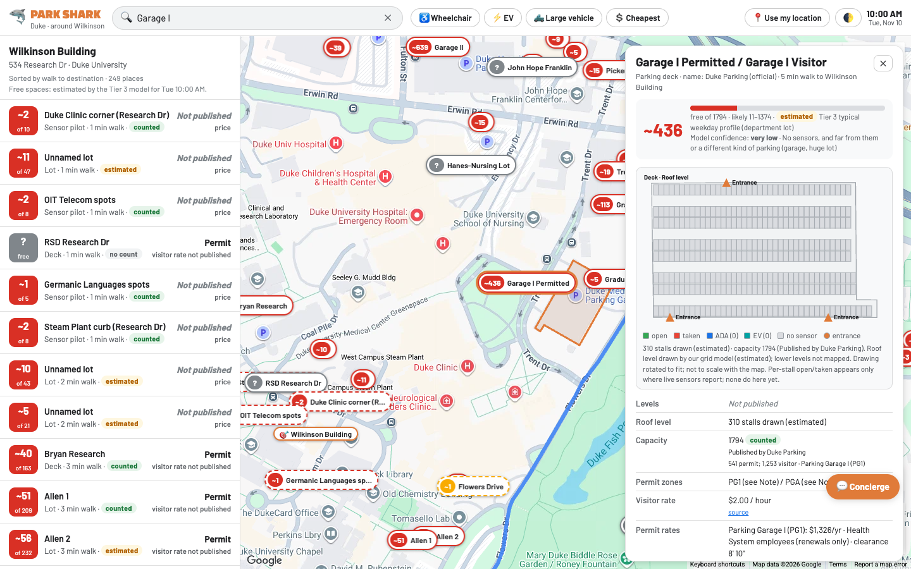

# 🦈 ParkShark Duke

**See how many spaces are free in every lot around Duke's Wilkinson Building, then open any lot to see its real stall layout.**

### 🔗 Live demo: **https://parkshark-blond.vercel.app**

Triangle AI Hackathon · Robotics track · [Privacy](privacy.html) · Code: [github.com/momacaes9/parkshark](https://github.com/momacaes9/parkshark)



## Inspiration
Around Duke's West and Science campus, drivers circle lots looking for a free stall. A full lot next to the building usually loses to an emptier lot five minutes' walk away, but nobody can see that from the car. Map apps show a "P" pin with no stall count, no price, no permit rules and no curb parking. We wanted one map that answers "where can I park right now, and what will it cost?", using only data we can source.

## What it does
- **One clean map.** Google Maps shows every lot, deck and on-street segment within 1.5 km of Wilkinson (534 Research Dr). Each pin is labeled with its name and number of free spaces, colored 🟢 70%+ free, 🟡 30–70%, 🔴 under 30%, ⚪ capacity not published. The main map shows no stall grids.
- **Click for the exact layout.** Any lot, deck or street segment opens a side panel with an SVG schematic of its stalls:
  - open, taken, ♿ ADA and ⚡ EV stalls, plus the entrance;
  - for parking decks, a **roof level** plus the number of levels.
- **Real facts with sources.** The panel lists the official Duke name, capacity and how it was obtained, permit zones, visitor rate, hours, ADA/EV counts and a source link.
  - Every number has a confidence badge: **measured** (live sensor), **counted** (published or surveyed) or **estimated** (model).
  - Anything we could not source shows **"Not published"**. We never invent names, prices or spaces.
- **Free-space forecasts.** Jacob's Tier 3 model estimates occupancy for any hour, with a confidence level (medium, low or very low). Live sensor readings replace the estimate whenever a sensor is reporting.
- **Search, filters and location.** Search lots, streets and destinations. Filter chips: ♿ Wheelchair, ⚡ EV, 🛻 Large vehicle, 💲 Cheapest. **Use my location** stays on your device. Light and dark mode.
- **💬 Parking Concierge.** Ask "visitor arriving 9:30 for 3 hours, budget $10". Google Gemini (`gemini-2.5-flash`) calls our ranking, price and lot-detail functions through function calling, then answers with a lot and highlights it on the map.
- **Pay demo.** Google Pay in **TEST** mode, labeled "Demo, no real charge". No card data reaches us and nothing is stored.

## How we built it
**Data (real sources only, in priority order)**

| Layer | Source | Priority |
| --- | --- | --- |
| Facility names, rates, permits, published capacities, on-street rules, Lewis St traced bays | Anne's Duke atlas (`structured-map`: Duke Parking & Transportation, Duke Campus Maps, Durham 2025 orthophotos) | 1st: official |
| Lot outlines, mapped stalls, capacity tags, `building:levels` | OpenStreetMap (ODbL) | 2nd |
| Estimated stalls, deck roof grid | Our grid model inside the real OSM outline | labeled *estimated* |
| Free spaces | Live sensors (Supabase) when reporting, else Jacob's Tier 3 model (`tier3-ai-estimate`) | *measured* / *estimated* |
| Posted signs | City of Durham parking-sign inventory | as published |

- A Duke facility is joined to an OSM lot only when the Duke point lies **inside** the OSM polygon. A capacity Duke publishes for a whole permit zone is shown as a zone note, not as one lot's capacity.
- **Capacity priority:** Duke published → OSM `capacity` tag → individually mapped OSM stalls → roof stalls × levels → our estimated grid.
- ADA/EV stalls are marked only when Duke or OSM says so. There is no rule-of-thumb fill.
- `scripts/build_main.py` merges everything into `data/main.json` (pins and facts) and `data/layouts.json` (stall schematics in each lot's own rotated metric frame).

**Occupancy (Tier 3 model)**
- `tier3_model/park_shark.py`: scikit-learn gradient boosting with quantile loss (10th/50th/90th percentile).
  - Trained on public car-park data (Birmingham UK, The Hague), then blended with a campus template.
  - Not yet calibrated on Duke counts, so it is always shown as *estimated*, with its confidence level.
- Order of use: live sensor rows (`occupancy_latest`) → Tier 3 sensor groups (medium confidence) → nearby lots (low or very low) → typical campus profile (very low).

**Hardware (sensor pilot)**
- A 24 GHz gate radar triggers plate OCR **on a Raspberry Pi**. The plate is hashed immediately and the image is deleted.
- A 60 GHz radar tracks which stall the car stops in, and magnetometers count cars in and out. LoRa carries only hashed IDs and timestamps.

**App**
- `index.html` + `app.js` + `style.css`: Google Maps JS (Advanced Markers, Places autocomplete). It falls back to Leaflet with OSM tiles when no key is configured.
- `api/config.js` serves the public browser config from server environment variables.
- `api/concierge.js`: a Vercel serverless proxy to Gemini 2.5 Flash with function calling. It keeps `GEMINI_API_KEY` on the server, with per-IP rate limiting, size caps and a timeout. The browser runs the tool loop, so the key never reaches it.
  - A key starting with `AQ.` uses Vertex AI express mode (`aiplatform.googleapis.com`). Any other key uses the Gemini API (`generativelanguage.googleapis.com`).
- `supabase.sql`: `occupancy` and `occupancy_latest` (public read), and `vehicle_events` (hashed plates, no public access, 30-day purge).
- The earlier analyst dashboard (stall packing along aisles, curb candidates verified by CV on NC OneMap imagery, game-day rules, spot score) is still at [`classic.html`](https://parkshark-blond.vercel.app/classic.html).

## Real numbers (1.5 km around Wilkinson)
| | |
|---|---|
| Lots and decks on the map | **309** (19 multi-level decks) |
| Lots with an official Duke name | **77** |
| Lots with published permit zones / hours | **65** / **61** |
| Lots with a published visitor rate | **13** (others say "Not published") |
| Capacity basis | **33** counted (published or tagged), **227** estimated, **49** not published |
| Stalls drawn in schematics | **16,012** across 275 layouts |
| ADA / EV stalls tagged by a source | **4** / **13**: most lots don't publish them, so we don't guess |
| On-street segments | **5** Duke-rule streets (Lewis St with 22 traced bays) + **4** sensor-pilot groups |
| Tier 3 forecasts | **4** sensor groups + **5** nearby lots, each with a confidence level |

## Challenges we ran into
- **Real data is sparse.** OSM has lot outlines but almost no stalls, EV chargers or curb tags here, and Duke publishes names and rates without coordinates. We kept every gap visible as "Not published" instead of filling it.
- **Joining sources honestly.** Proximity matching put Duke names on the wrong lots, so we switched to point-in-polygon joins. Capacities like "541 permit; 1,253 visitor" must be summed, and zone-wide counts must not be pinned to a single lot.
- **A model with no Duke data.** The Tier 3 forecast had to be clearly labeled with its confidence and replaced the moment a sensor reports.
- **Merging three teammates' branches** (map rebuild, Duke atlas, Tier 3) on a deadline without losing anyone's work.

## Accomplishments that we're proud of
- Every number on the map can be traced to a source or is labeled as an estimate.
- A clean, Google-Maps-style experience on top of honest data, with a stall-level schematic for 275 lots and decks.
- A privacy-first sensor design: hashed plates, images deleted on the device, and no location tracking.

## What we learned
Confidence labels matter as much as the numbers themselves. Users trust "estimated, low confidence" more than a precise-looking guess.

## What's next
- Install the radar and magnetometer pilot in the Science (Physics) Lot and calibrate Tier 3 on real Duke counts.
- Map ADA stalls, EV chargers and garage floor plans; contribute verified data back to OSM.
- Real reservations and payment through Duke Parking's Blue Spot.

## Built with
Google Maps JavaScript API · Leaflet · OpenStreetMap · Python · scikit-learn · Google Gemini 2.5 Flash (Gemini API / Vertex AI) · Vercel serverless · Supabase · Google Pay (TEST) · Raspberry Pi · LoRa · mmWave radar

## Team
Ishan (founder, product) · Anne (Duke parking atlas) · Jacob (Tier 3 occupancy model) · Monica (map, app and deployment)

## Security & privacy
- `.env` and `config.js` are gitignored and never committed. API keys exist only as Vercel environment variables.
- `/api/config` returns only public browser values: the Google Maps key (restrict it to this site's referrers) and the Supabase anon key (RLS enforced). `GEMINI_API_KEY` and `SUPABASE_SERVICE_KEY` stay on the server.
- Concierge messages go through our server to Google's Gemini API; your location is never included.
- Geolocation never leaves the browser. Plates are hashed on the device, images are deleted right after OCR, and events are purged after 30 days. See [privacy.html](privacy.html).

## Run it
```bash
npm install
cp .env.example .env                # GEMINI_API_KEY, GOOGLE_MAPS_KEY, SUPABASE_URL, SUPABASE_ANON_KEY (gitignored)
npm start                           # http://localhost:8000 (static + /api)
```
Rebuild the data: `python3 scripts/build_data.py && python3 scripts/build_main.py`.
Deploy: `npx vercel --prod`. Add each key once with `npx vercel env add NAME production`. Without `GOOGLE_MAPS_KEY` the map falls back to OpenStreetMap tiles.
Demo switch: `?date=2026-11-10&hour=9` shows the forecast for another date and hour.

---

## ParkShark — Duke Parking Atlas

A static parking explorer for Duke and nearby Durham, with source-backed rules and separately labeled layout estimates. [Live dashboard](https://parkshark-duke-atlas.jpama.chatgpt.site/). Serve the checked-in `dist/` directory; no API key, backend, or package installation is required.

```sh
python3 -m http.server 4173 --directory dist
```

Open `http://localhost:4173`. For another static host, publish `dist/` as-is. Netlify can use the included configuration. The dashboard and GitHub repository have separate access controls.

### Snapshot: November 7, 2026

- 128 Duke official facility reference points. Visitor/permit sections can be separate points in one physical garage; this is not a count of distinct lots.
- 498 community-mapped lot polygons and one additional OSM parking point.
- 31 existing parking-space polygons. Several contain groups of bays; this is not 31 verified individual stalls.
- 12,917 **low-confidence modeled bay shapes** across 169 mapped surface lots, plus 40 **imagery-guided estimates** across three partially traced surface lots. These are shape counts. Zoom in and use **Estimates** to toggle this layer.
- 22 **estimated on-street bays** on Lewis Street, separate from Duke’s published 44-space count. See [Lewis Street on-street estimates](#lewis-street-on-street-estimates).
- 3,885 Durham parking signs located by the authoritative sign-to-pole foreign key; six explicitly inactive records excluded, 29 unknown-status records retained.
- 18 road-centerline features for five named Duke streets with published visitor parking rules. The lines do not establish permitted curb extents.
- Eight additional OSM street-centerline segments with community parallel-parking tags.
- 48 published annual permit-rate entries and 21 visitor-table entries retained in the rule snapshot. Only verified exact associations are attached to map points. Some current-rate entries have no location in the campus map feed.

The map exposes permit eligibility, visitor prices, scoped capacity strings, after-hours access, five known EV facility locations (six mapped sections), and known accessible parking. Missing facts remain null. Capacity is not occupancy. Approximate campus area labels follow Duke's facility-code prefixes.

### Data provenance

The app's **Sources & coverage** panel links every authoritative source and explains conflicts. Each exported feature retains its original source identity. Duke rates are joined by explicit facility IDs, with documented corrections in `scripts/build_data.py`; there are no spatial or fuzzy joins between Duke points and OSM polygons.

`source-data/` preserves the downloaded inputs required to reproduce `dist/data/`:

```sh
python3 scripts/build_data.py
python3 scripts/validate_data.py
```

### Modeling

**Surface geometry model.** [`scripts/estimate_spaces.py`](scripts/estimate_spaces.py) selects whole OpenStreetMap (OSM) polygons explicitly tagged `parking=surface` within the study boundary. It projects them into UTM zone 17N to work in metres, subtracts a 1.2 m perimeter setback, buffered buildings and known space polygons, and fits 2.6 × 5.4 m rectangles. For each usable polygon it tests two orientations and eight grid offsets per orientation. It keeps the layout with the most rectangles for which both the bay and a 6.2 m adjacent aisle slice fit. The dimensions are modeling assumptions. The [model manifest](source-data/estimates/manifest.json) records the boundary, assumptions, omissions, and counts per source lot before publication filters.

**Why small lots can be undercounted.** A polygon drawn tightly around a row can omit the driveway or shared aisle used to reach it. The grid can then fit zero bays even when stripes are visible. Irregular boundaries, missing tags and setbacks can also reduce coverage. A zero or missing estimate means the model found or drew no bays. Where OSM supplies a `capacity` tag, the detail panel shows that unverified community count separately. For example, [Branson Hall Parking](https://www.openstreetmap.org/way/611698330) reports four spaces in OSM and has one modeled shape. Shadows in the reviewed imagery prevent a reliable trace there.

**Aerial review.** At reviewed lots the build uses a partial trace from [Durham's 2025 orthophotos](https://webgis2.durhamnc.gov/server/rest/services/Rasters/Ortho2025/MapServer) and omits synthetic shapes for the same OSM footprint. Each trace covers a specific visible area and leaves unreviewed areas blank. The [small-lot anchors](source-data/estimates/small-lot-anchors.json) record exact lot IDs, image tile origins and divider endpoints. The builder converts adjacent endpoints into WGS84 polygons. The tiles themselves are fetched on demand and are not bundled.

| Footprint | Bays drawn in the previous build | Bays drawn now | Evidence |
| --- | ---: | ---: | --- |
| [Surface lot 1065904267](https://www.openstreetmap.org/way/1065904267) | 0 | 2 | Readable painted dividers in the north row. |
| [Surface lot 594764289](https://www.openstreetmap.org/way/594764289) | 0 | 8 | Repeated markings in the west part of one row, with some divider ends interpolated around vehicles. The trace follows the imagery and extends slightly beyond the community footprint at the aisle edge. |
| [Bryan Center surface lot](https://www.openstreetmap.org/way/32336367) | 30 | 30 | Northeast row anchors and interpolated bay divisions. |

**Counts and confidence.** Published Duke counts keep their original scope, including shared facilities and designated visitor subsets. OSM capacity tags are community reports. Modeled counts are numbers of synthetic shapes with low confidence. Aerial counts are numbers of traced or interpolated shapes, with medium confidence in row placement and varying visibility of individual dividers. A field count or a current facility plan is needed for full capacity. The estimates do not establish access, accessible or EV designation, or occupancy. Garage interiors remain unmapped.

To regenerate the estimates using Python 3.12:

```sh
python3 -m pip install -r scripts/requirements-geometry.txt
python3 scripts/estimate_spaces.py
python3 scripts/trace_bryan.py
python3 scripts/trace_lewis.py
python3 scripts/build_data.py
python3 scripts/validate_data.py
```

The exported snapshot keeps `estimatedBayLayouts` and `estimatedCurbLayouts` separate from `spaceFootprints`. `estimateSummary.lotCounts` tallies displayed surface shapes by OSM ID and `estimateSummary.imageryLots` records the count and scope of each partial trace. Estimated IDs can support review and reconciliation. The occupancy adapter uses existing source space footprints.

### Lewis Street on-street estimates

**Open the layout:** [Lewis Street on the live map](https://parkshark-duke-atlas.jpama.chatgpt.site/?street=Lewis%20Street). From the main map, choose **On-street**, search **Lewis Street**, and select **View curb estimates on aerial**. Blue dashed outlines are estimated bays. The orange dashed road centerline is a reference line. The **Estimates** toggle controls the blue layer.

| What the map shows | Source and interpretation |
| --- | --- |
| 44 published visitor spaces; daily 8 a.m. to sunset while the Gardens grounds are open | [Duke Gardens](https://gardens.duke.edu/visit/parking/). This count describes the street-level visitor inventory. |
| Blue Spot, $2/hour plus transaction fees | [Duke Parking & Transportation](https://parking.duke.edu/visitor-parking/blue-spot-hourly-parking/). Applies to signed visitor parking. |
| 22 medium-confidence bay polygons: 5 west-middle, 5 middle, 12 east | Manually placed on readable painted dividers in [Durham's 2025 orthophotos](https://webgis2.durhamnc.gov/server/rest/services/Rasters/Ortho2025/MapServer). All are on the north side next to H Lot. Each polygon comes from a pair of adjacent stripe endpoints. |
| Unmapped gaps | Foliage, shadows, vehicles and equipment hide parts of the row. The opposite curb, intersections, entrances and H Lot's interior rows were excluded. |

**Interpretation:** 22 is the number of drawn estimates, not the number of spaces available, surveyed, or legally confirmed. The 44-space count was never used to place or fill bays. The geometry does not establish current signs, ADA or EV designation, or occupancy. These fields are `null` on every estimate. Check signs on arrival.

**Rebuild and review:** `source-data/estimates/lewis-curb-anchors.json` records the mosaic tile range, individual stripe endpoints, omissions, and source links. Run `python3 scripts/trace_lewis.py`, `python3 scripts/build_data.py`, then `python3 scripts/validate_data.py`. This is an offline rebuild with the Python standard library; no imagery downloads are required. The first command converts the recorded pixel anchors to WGS84 and writes `source-data/estimates/lewis-curb.geojson`. The build copies the geometry to `dist/data/curb-estimates.geojson`, which the app exports as `estimatedCurbLayouts` in snapshot schema 3.

**Overlap handling:** The anchors also describe a mask around the curb row, including obscured gaps. The build removes 47 surface-model shapes that overlap the mask. The mask is metadata for de-duplication; it is neither drawn as parking nor used to assign parking permission. The original model inputs are retained for reproducibility.

The public campus map returns null parking geometry and car-capacity fields; bike-rack capacity values are deliberately excluded. Duke's historical library GIS archives require authorized access and were not used. Current exact stall geometry, garage floor plans, and signed curb spans remain the largest coverage gaps. The map is not 90% complete at individual-stall level.

OSM geometry is © OpenStreetMap contributors under ODbL-1.0; its layers and attribution remain separate. Duke and Durham source facts retain their source URLs and applicable reuse terms. The basemap uses normal interactive OSM tiles with visible attribution and browser caching, without bulk/offline downloads. Aerial tiles are City of Durham/Durham County GIS 2025 orthophotography, native zoom 20. Internet is needed for basemaps and optional fonts; all parking records and the Leaflet library are bundled.

### Fill in the missing spaces

Choose **Map spaces**, switch to the aerial view, and zoom to 19+. Select a facility and click the four corners of one visible bay in order. Implausible/crossed polygons are rejected. Drafts use stable IDs, remain local to the browser, and can be exported as GeoJSON. They are explicitly marked `needs-review`; they are not silently added to the published source data. Accessible/EV classifications still require evidence. A covered garage needs floor plans or a field survey; aerial imagery cannot reveal its interior stalls.

### Occupancy integration

`dist/data/occupancy.json` is an intentionally empty adapter seam. The app reads it on page load. Replace this file (or change the fetch URL in `app.js`) with the team's feed using:

```json
{
  "schemaVersion": 1,
  "updatedAt": "2026-11-07T18:00:00Z",
  "observations": [
    {
      "featureId": "a-real-source-feature-id",
      "status": "occupied",
      "observedAt": "2026-11-07T18:00:00Z"
    }
  ]
}
```

Supported statuses are `occupied` and `vacant`. Records older than five minutes, future timestamps and IDs not present in the geometry layer are ignored. No feed is connected and no demonstration occupancy is generated. The current adapter colors source space footprints; review grouped geometries before treating them as single stalls. Production streaming/polling and capacity aggregation belong in the occupancy service.

### Publication

The live dashboard is hosted on Sites, where its audience is managed separately. This repository is portable: its `dist/`, scripts, and input data can run and deploy independently of the Sites checkout.
